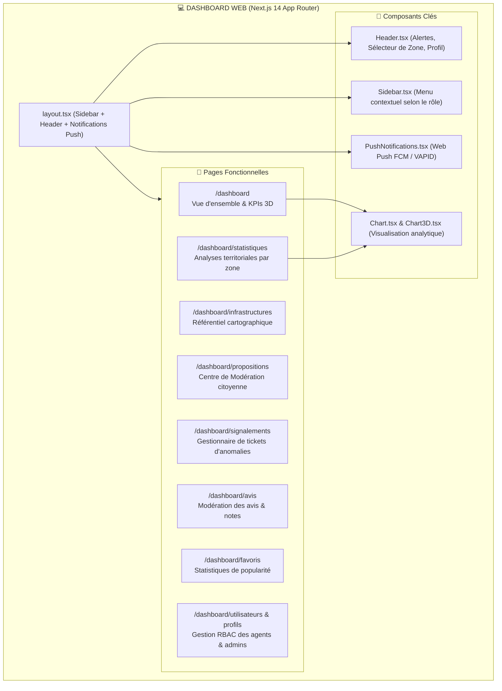
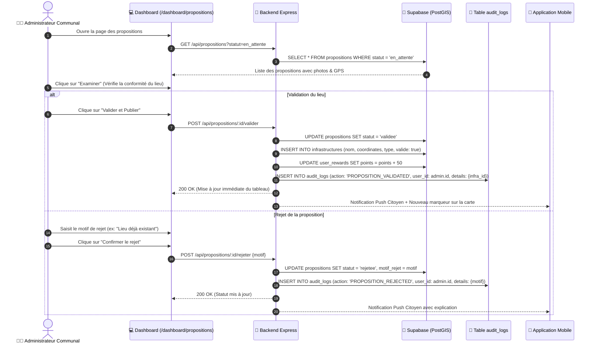
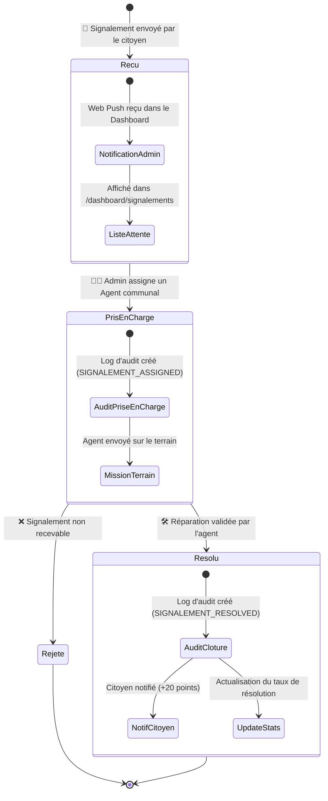

# 💻 Architecture & Traçabilité du Dashboard Web - KutonouTché

Ce document détaille l'architecture interne du tableau de bord d'administration (**Next.js 14 App Router**, **Tailwind CSS**, **Recharts**) et la **traçabilité des actions** effectuées par les gestionnaires communaux.

---

## 📑 Sommaire
1. [Architecture Modulaire du Dashboard](#1-architecture-modulaire-du-dashboard)
2. [Workflow de Modération & Traçabilité des Décisions](#2-workflow-de-modération--traçabilité-des-décisions)
3. [Gestion des Signalements & Traçabilité Terrain](#3-gestion-des-signalements--traçabilité-terrain)
4. [Gestion des Droits (RBAC) & Sécurité](#4-gestion-des-droits-rbac--sécurité)
5. [Flux Temps Réel Web Push (FCM / VAPID)](#5-flux-temps-réel-web-push-fcm--vapid)

---

## 1. Architecture Modulaire du Dashboard

Le Dashboard est structuré selon les rôles et les domaines fonctionnels de la plateforme :



---

## 2. Workflow de Modération & Traçabilité des Décisions

Toute décision prise sur une proposition citoyenne est strictement enregistrée pour garantir l'intégrité des données publiques.



---

## 3. Gestion des Signalements & Traçabilité Terrain

Suivi en temps réel des incidents signalés par les citoyens sur les équipements communaux :



---

## 4. Gestion des Droits (RBAC) & Sécurité

La sécurité du Dashboard repose sur un contrôle d'accès basé sur les rôles (RBAC) vérifié à chaque requête :

| Rôle | Périmètre d'action | Menus visibles | Logs d'audit consultables |
| :--- | :--- | :--- | :--- |
| **Super Admin** | National / Tout Cotonou | Tous les menus (Infras, Propositions, Signalements, Utilisateurs, Statistiques, Audit) | **Tous les logs du système** |
| **Admin Communal** | Arrondissement / Zone assignée | Infras, Propositions et Signalements de sa zone | **Logs de sa zone uniquement** |
| **Agent de Modération** | Traitement des tickets assignés | Signalements et consultation des fiches | **Ses propres actions uniquement** |

---

## 5. Flux Temps Réel Web Push (FCM / VAPID)

Comment le tableau de bord reçoit les alertes instantanées sans nécessiter de rafraîchissement manuel de page :

```mermaid
flowchart LR
    Citoyen["👤 Citoyen sur Mobile<br/>(Signale un problème)"] -->|POST /api/signalements| Backend["🔧 Backend API"]
    Backend -->|FCM Push Message| Firebase["🔥 Firebase Cloud Messaging"]
    Firebase -->|Web Push Protocol (VAPID)| Browser["💻 Navigateur Dashboard"]
    Browser -->|Affichage Toast & Badge| Header["Header.tsx (Compteur d'alertes)"]
```
